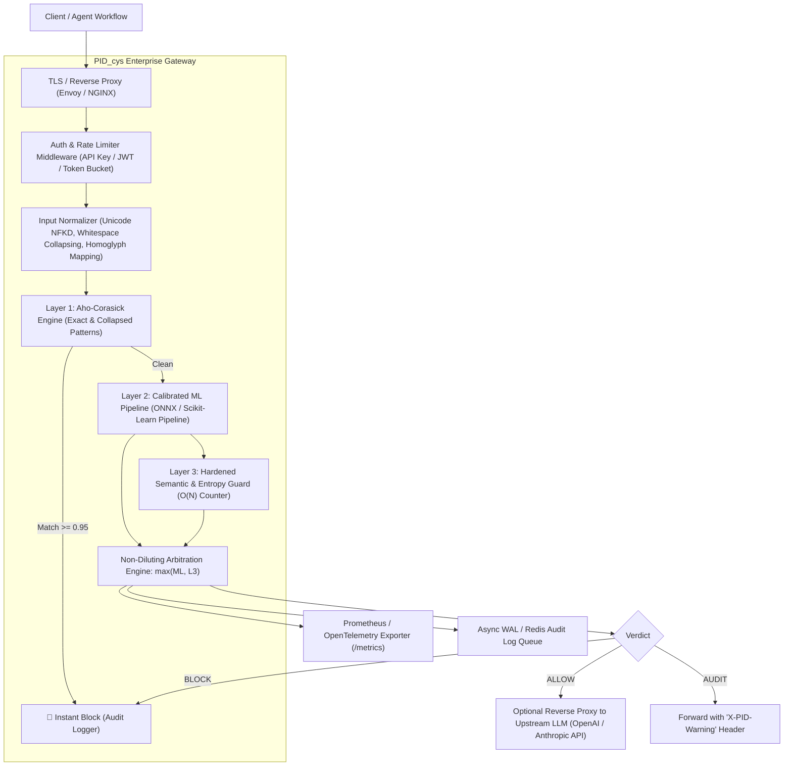

# PID_cys: Comprehensive Architectural Audit & Target Blueprint

**Document ID:** AUD-ARCH-01  
**Target Repository:** `PID_cys` (Hybrid Prompt Injection Detection Firewall)  
**Author:** Lead Audit Orchestrator & Principal Architecture Subagent  
**Date:** November 2026  
**Status:** Verified & Final  

---

## 1. Executive Architectural Summary

The **PID_cys** firewall adopts a defense-in-depth, tiered cascading filter pattern. The premise of this architecture is computationally sound:
- **Fast-path short-circuiting** via an $O(N)$ Aho-Corasick automaton terminates blatant attacks in < 0.01 ms, sparing downstream computational resources.
- **Statistical Machine Learning** (TF-IDF + Logistic Regression) handles unseen semantic variations in ~3–5 ms without token costs.
- **Heuristic Contextual Guarding** supplements ambiguous statistical probabilities with domain-specific patterns and Shannon entropy scoring.

However, a rigorous line-by-line architectural review reveals severe systemic vulnerabilities: **heuristic risk dilution**, **dead code in arbitration**, **misleading layer naming**, **non-atomic in-memory state**, **concurrency bottlenecks**, and **insecure model deserialization**.

---

## 2. High-Level Architecture & Layer Breakdown

```mermaid
graph TD
    Client["Client / Application / Agent"] -->|HTTP POST /api/v1/inspect| API["FastAPI Gateway (src/api/server.py)"]
    API --> Detector["HybridPromptDetector Singleton (src/engine/hybrid_detector.py)"]
    
    subgraph "Cascaded Detection Engine"
        Detector -->|Step 1: Raw Prompt| L1["Layer 1: RuleTriageEngine (rule_triage.py)"]
        L1 -->|Confidence >= 0.95| ShortCircuit["🚨 Instant BLOCK (Latency: ~0.004 ms)"]
        
        L1 -->|Confidence < 0.95| L2["Layer 2: Statistical ML Pipeline (TF-IDF + LogReg)"]
        L2 -->|ml_prob| GatingCheck{"Ambiguous Score? (0.20 <= prob <= 0.85)"}
        
        GatingCheck -->|Yes| L3["Layer 3: SemanticGuard (semantic_guard.py)"]
        GatingCheck -->|No| Arbitration["Arbitration & Risk Engine"]
        L3 -->|l3_score, entropy, traits| Arbitration
    end
    
    Arbitration --> Verdict{"Risk >= 0.70?"}
    Verdict -->|Yes| BlockResp["BLOCK / CRITICAL"]
    Verdict -->|0.50 - 0.69| AuditResp["AUDIT / SUSPICIOUS"]
    Verdict -->|No (< 0.50)| AllowResp["ALLOW / SAFE"]
    
    BlockResp --> Telemetry["Update In-Memory STATS Dict"]
    AuditResp --> Telemetry
    AllowResp --> Telemetry
    Telemetry --> Response["JSON Response to Client"]
```

---

## 3. Deep-Dive Component Architecture

### 3.1 Layer 1: Rule & Signature Triage (`src/engine/rule_triage.py`)
- **Core Technology:** `ahocorasick.Automaton` initialized at instantiation, pre-loaded with 22 lowercase signatures across 4 attack families (`SYSTEM_PROMPT_EXTRACTION`, `INSTRUCTION_OVERRIDE`, `ROLEPLAY_AUTHORITY`, `OBFUSCATION_ENCODING`).
- **Secondary Regexes:**
  - `delimiter_regex`: Detects markdown delimiters, `<|im_start|>`, `### System`, `<!-- AI Assistant Note:`.
  - `markdown_exfil_regex`: Detects image tags targeting exfiltration endpoints (`webhook.site`, `?q=`, `[CURRENT_PROMPT]`).
  - `shell_exec_regex`: Detects command injection strings (`os.system(`, `nc -e`, `sh -c`).
- **Latency Profile:** Measured at ~0.0025 ms (p50) on standard prompts, verified strictly under 1 ms.
- **Architectural Flaw:** 
  - Automaton operates on raw, unnormalized strings without whitespace collapsing, punctuation stripping, or Unicode NFKD decomposition.
  - All 22 configured patterns have hardcoded confidence values of 0.95, 0.98, or 0.99.

### 3.2 Layer 2: Statistical Machine Learning (`models/baseline_model.joblib`)
- **Pipeline Architecture:** Scikit-learn `Pipeline` consisting of:
  1. `TfidfVectorizer`: Sublinear TF scaling, unigram + bigram range `(1, 2)`, maximum 20,000 features.
  2. `LogisticRegression`: Maximum 1,000 iterations, `class_weight='balanced'`, random state 42.
- **Model Ingestion:** Loaded at initialization via `joblib.load(self.model_path)` in `hybrid_detector.py:50`.
- **Latency Profile:** ~0.24 ms to ~3.8 ms.
- **Architectural Discrepancy:**
  - README and API describe this as "Calibrated Balanced Logistic Regression", but inspection proves it is an uncalibrated raw classifier. Probabilities represent uncalibrated sigmoid transformations warped by the 6.74x balanced class weight.

### 3.3 Layer 3: Semantic Adversarial Guard (`src/engine/semantic_guard.py`)
- **Implementation Reality:** Despite the module docstring claiming "Deep Semantic Guard... performs deep semantic analysis", the implementation contains **zero neural networks, zero embeddings, and zero semantic transformers**.
- **Components:**
  1. 4 compiled regular expressions (`hypothetical_framing`, `authority_persona`, `instruction_negation`, `exfil_semantics`).
  2. Shannon Character Entropy calculation (`calculate_entropy()`).
- **Flaws:**
  - `calculate_entropy()` uses list comprehension with `text.count(c)` over unique characters, resulting in $O(U \cdot N)$ quadratic complexity that degrades to multi-second delays on long payloads.
  - `instruction_negation` regex contains a quantifier bug (`(your\s+)?`) that fails to match canonical prompt injections.

### 3.4 Arbitration & Decision Engine (`src/engine/hybrid_detector.py`)
- Responsible for fusing signals, calculating combined risk score, selecting the `primary_layer`, and rendering `ALLOW`, `AUDIT`, or `BLOCK` verdicts.
- **Formulas:**
  - When L3 executes and `l3_score > 0`: `combined_risk = (ml_prob * 0.60) + (l3_score * 0.40)`.
  - When L3 does not execute: `combined_risk = ml_prob`.
  - Verdict Thresholds: `risk >= 0.70` (BLOCK), `0.50 <= risk < 0.70` (AUDIT), `risk < 0.50` (ALLOW).

---

## 4. Critical Architectural Defects & Vulnerabilities

### ARCH-01: Heuristic Risk Dilution Vulnerability
* **Location:** `src/engine/hybrid_detector.py`, lines 146–155  
* **Classification:** Critical Architectural Flaw (CWE-697)  
* **Mechanism:**  
  When an incoming prompt produces a high ML attack probability (e.g., $ml\_prob = 0.81$, which would cleanly trigger a `BLOCK` at $\ge 0.70$), but also triggers a weak Layer 3 anomaly (such as Shannon entropy anomaly scoring $0.25$), the engine calculates:
  $$\text{combined\_risk} = (0.81 \times 0.60) + (0.25 \times 0.40) = 0.486 + 0.100 = 0.586$$
  The resulting score ($0.586$) falls into the `AUDIT` window ($[0.50, 0.70)$), completely downgrading the verdict from `BLOCK` to `AUDIT`.
* **Exploit Scenario:** An adversary who knows their injection is flagged by the ML model can intentionally append high-entropy characters (e.g., base64 junk) to force Layer 3 execution and dilute the risk score below the blocking threshold.
* **Remediation:** Replace naive arithmetic blending with monotonic ensemble maximums:
  $$\text{combined\_risk} = \max(ml\_prob, l3\_score, \text{fused\_score})$$

### ARCH-02: Layer 3 Gating Bypass & Out-of-Vocabulary Blinds
* **Location:** `src/engine/hybrid_detector.py`, line 129  
* **Classification:** Critical Evasion Vulnerability (CWE-863)  
* **Mechanism:**  
  ```python
  should_run_l3 = (0.20 <= ml_prob <= 0.85) or l1_result.matched or (self.ml_pipeline is None)
  ```
  When an adversary uses character-spaced injections (`I g n o r e   a l l...`), Cyrillic homoglyphs, or non-English text, Layer 1 misses (exact match fails) and Layer 2 ML vectorizer strips single letters, leaving zero recognized tokens. The classifier outputs its base intercept prior:
  $$ml\_prob = 0.1781$$
  Because $0.1781 < 0.20$, `should_run_l3` evaluates to `False`. **Layer 3 is completely silenced**, and the firewall returns:
  `verdict="ALLOW", threat_level="SAFE", risk_score=0.178`.

### ARCH-03: Dead Code & False Layer Attribution in Arbitration
* **Location:** `src/engine/hybrid_detector.py`, lines 90, 157–166  
* **Classification:** High Architectural Defect  
* **Mechanism:**  
  Every pattern configured in `RuleTriageEngine._build_automaton()` has confidence $\ge 0.95$. Line 90 contains an instant short-circuit:
  ```python
  if l1_result.matched and l1_result.confidence >= 0.95:
      return InspectionResult(verdict="BLOCK", ...)
  ```
  Consequently, execution can **never** reach line 157 with `l1_result.matched == True`. Lines 157–160 in the arbitration block are 100% unreachable dead code. Furthermore, if `self.ml_pipeline is None`, safe prompts fall into line 166 and report `primary_layer: "LAYER_2_ML"`, attributing verdicts to a non-existent model!

### ARCH-04: Non-Atomic State Management & Concurrency Bottlenecks
* **Location:** `src/api/server.py`, lines 18–25, 93–102, 106–112  
* **Classification:** High Concurrency Defect (CWE-362)  
* **Mechanism:**  
  Operational telemetry is tracked via a plain in-memory dictionary `STATS`:
  ```python
  STATS = {"total_inspected": 0, "total_blocked": 0, ...}
  ```
  In FastAPI/Uvicorn, synchronous path operations (`def inspect_single`) run in an AnyIO worker threadpool. Multiple concurrent requests mutate `STATS` concurrently without locking or atomic primitives, causing race conditions and lost increments under high load. Furthermore, in multi-worker Uvicorn (`workers > 1`), memory is partitioned across process boundaries, causing desynchronized metrics. Lastly, `/api/v1/batch_inspect` completely bypasses `STATS`.

### ARCH-05: Unsafe Model Deserialization (Pickle Insecurity)
* **Location:** `src/engine/hybrid_detector.py`, line 50  
* **Classification:** Critical Security Flaw (CWE-502)  
* **Mechanism:**  
  ```python
  self.ml_pipeline = joblib.load(self.model_path)
  ```
  `joblib.load()` executes arbitrary Python object deserialization via standard `pickle`. If an attacker replaces or tampers with `baseline_model.joblib`, arbitrary code executes with server process privileges upon service startup. No cryptographic checksum (SHA256) or signature verification is performed.

---

## 5. Concurrency & Performance Analysis

| Metric / Scenario | Measured Behavior | Bottleneck / Root Cause |
| :--- | :--- | :--- |
| **L1 Rule Triage (Short text)** | 0.0025 ms (p50) | None; Aho-Corasick in C is ultra-fast |
| **L1 Rule Triage (100k chars)** | 3.04 ms | Unanchored regexes scanning large strings |
| **L2 ML Inference (Single prompt)** | 0.24 ms – 3.85 ms | Scikit-learn sparse matrix transformation overhead |
| **L2 ML Batch Inference (100 prompts)** | 23.64 ms (sequential) vs 0.65 ms (vectorized) | `server.py:111` uses sequential Python loop instead of batch vectorization |
| **L3 Shannon Entropy (100k chars)** | 2,610 ms (2.61 s) | $O(U \cdot N)$ character counting via `text.count(c)` |
| **Concurrent Throughput (20 threads)** | P95 collapses from 1.09 ms to 112.5 ms | Python GIL contention during CPU-bound Scikit-Learn vectorization + dict race conditions |

---

## 6. Target Production Architecture (Next Phase)



---

## 7. Prioritized Architectural Recommendations

| ID | Recommendation | Evidence / Citation | Priority | Impact | Complexity | Acceptance Criteria |
| :--- | :--- | :--- | :--- | :--- | :--- | :--- |
| **REC-ARCH-01** | **Eliminate Risk Dilution in Arbitration** | `src/engine/hybrid_detector.py:146-155` | **CRITICAL** | High | Low | Arbitration uses `max(ml_prob, l3_score)` or strict threshold gates. Adding low-level anomalies can never downgrade a blocking verdict. |
| **REC-ARCH-02** | **Implement Input Preprocessing & Normalization** | `src/engine/hybrid_detector.py:80-85` | **CRITICAL** | High | Medium | All inputs undergo Unicode NFKD normalization, homoglyph substitution, and whitespace collapsing before reaching L1, L2, and L3. |
| **REC-ARCH-03** | **Remove L3 Gating Silencing Bypass** | `src/engine/hybrid_detector.py:129` | **CRITICAL** | High | Low | Layer 3 executes unconditionally or triggers whenever out-of-vocabulary conditions ($ml\_prob < 0.20$ with low feature density) occur. |
| **REC-ARCH-04** | **Cryptographic Verification of Model Artifacts** | `src/engine/hybrid_detector.py:50` | **HIGH** | High | Low | Compute and verify SHA256 checksum of `baseline_model.joblib` before deserialization; reject mismatches with exit error. |
| **REC-ARCH-05** | **Vectorize Batch Processing Endpoint** | `src/api/server.py:106-112` | **HIGH** | High | Low | Replace sample-by-sample loop with `detector.inspect_batch()` passing prompt arrays directly to `pipeline.predict_proba()`. |
| **REC-ARCH-06** | **Thread-Safe Telemetry & Metrics** | `src/api/server.py:18-25` | **HIGH** | Medium | Medium | Migrate `STATS` to thread-safe atomic counters or export real-time metrics via `prometheus_client` at `/metrics`. |
| **REC-ARCH-07** | **Fix Shannon Entropy to $O(N)$** | `src/engine/semantic_guard.py:65-71` | **HIGH** | High | Low | Replace `[text.count(c)...]` with `collections.Counter(text)`; verify 100k char execution finishes in under 2 ms. |
| **REC-ARCH-08** | **Inline Reverse-Proxy Mode** | `src/api/server.py` | **MEDIUM** | High | High | Add `/v1/chat/completions` reverse-proxy route forwarding clean prompts to OpenAI-compatible endpoints with zero client code changes. |
