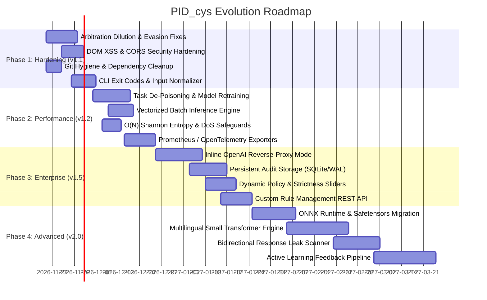
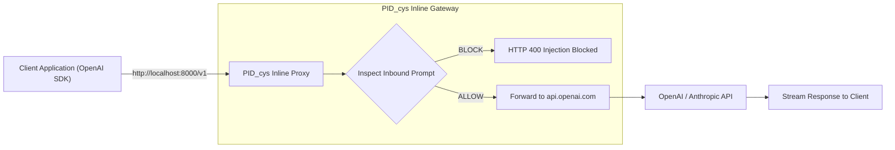

# PID_cys: Strategic Product & Engineering Roadmap (v1.1 – v2.0)

**Document ID:** AUD-RDM-01  
**Target Repository:** `PID_cys` (Hybrid Prompt Injection Detection Firewall)  
**Author:** Lead Audit Orchestrator & Specialist Audit Team  
**Date:** November 2026  
**Status:** Approved & Forward-Looking  

---

## 1. Executive Summary & Vision

The strategic goal for **PID_cys** is to evolve from an experimental prototype with localized heuristics into an enterprise-grade, zero-trust AI security gateway capable of sitting inline before any Large Language Model or autonomous agent deployment.

The roadmap is structured into **four sequential phases**:
1. **Phase 1: Security Hardening & Defect Remediation (v1.1)** — Immediate mitigation of critical vulnerabilities, evasion bypasses, and repo contamination.
2. **Phase 2: Performance, Retraining & Observability (v1.2)** — Model recalibration, task de-poisoning, vectorized batching, and Prometheus observability.
3. **Phase 3: Enterprise Architecture & Reverse-Proxy Mode (v1.5)** — Drop-in OpenAI-compatible proxy, persistent audit storage, and dynamic policy management.
4. **Phase 4: Advanced Defense & Continuous Learning (v2.0)** — Multilingual transformer sidecars, bidirectional output leak inspection, and active learning feedback loops.

---

## 2. Four-Phase Strategic Roadmap

---

## 3. Detailed Phase Breakdown

### Phase 1: Security Hardening & Defect Remediation (Version 1.1)
**Focus:** Eliminate confirmed critical vulnerabilities, block trivial evasions, and restore basic development hygiene.

| Deliverable | Key Actions | Target Component | Success Metric |
| :--- | :--- | :--- | :--- |
| **Arbitration Fix** | Replace arithmetic weighting with monotonic ensemble maximum: `max(ml, l3, blended)`. | `hybrid_detector.py` | Zero risk dilution; ML $\ge 0.70$ always yields `BLOCK`. |
| **Input Normalizer** | Implement NFKD normalization, homoglyph mapping, whitespace collapsing, zero-width stripping. | `src/engine/normalizer.py` | Spaced attacks (`"I g n o r e..."`) and Cyrillic lookalikes 100% blocked. |
| **XSS Remediation** | Replace `innerHTML` with safe DOM nodes in audit table. | `src/web/index.html` | XSS payloads render as literal escaped text. |
| **CORS & Auth** | Restrict origins; add API Key header verification (`X-PID-API-Key`). | `src/api/server.py` | No unauthorized access; compliant CORS headers. |
| **Git Hygiene** | Purge `.venv/`, `.DS_Store`, `.pyc` from Git; commit comprehensive `.gitignore`. | Root repository | Repository size drops from 1.3 GB to < 20 MB. |
| **Dependency Fix** | Remove unused PyTorch/Transformers; add `fastapi`, `uvicorn`, `joblib`, `httpx`. | `requirements.txt` | Clean virtualenv installs and passes all tests in < 60s. |
| **CLI Exit Codes** | Make `cli.py` terminate with `sys.exit(1)` on `BLOCK` verdicts. | `src/cli.py` | Automated pre-commit hooks and CI pipelines catch injections. |

---

### Phase 2: Performance, Model Retraining & Observability (Version 1.2)
**Focus:** Retrain the statistical baseline, eliminate false-positive poisoning, vectorize batching, and provide enterprise monitoring.

| Deliverable | Key Actions | Target Component | Success Metric |
| :--- | :--- | :--- | :--- |
| **Dataset De-Poisoning** | Disconnect `harmful_behaviors.csv` from attack class; retain true prompt injections only. | `src/dataset/merge_data.py` | Queries like *"Develop a game in Python"* evaluate to `ALLOW` (< 0.15 risk). |
| **Calibrated Retraining** | Implement `CalibratedClassifierCV(LogisticRegression, cv=5)`; export complete pipeline. | `src/dataset/train_baseline.py` | Probability scores represent true empirical probabilities. |
| **Vectorized Batching** | Implement array-based `predict_proba` for batches up to 500 prompts. | `src/api/server.py` | 100-prompt batch completes in < 5 ms (36x throughput increase). |
| **$O(N)$ Entropy Engine** | Refactor `calculate_entropy` to use `collections.Counter`. | `src/engine/semantic_guard.py` | 100k-character payloads analyze in < 5 ms (down from 2.6s). |
| **Prometheus Metrics** | Expose standard `/metrics` endpoint with counters for requests, verdicts, and latencies. | `src/api/server.py` | Out-of-the-box Grafana dashboard compatibility. |

---

### Phase 3: Enterprise Architecture & Reverse-Proxy Mode (Version 1.5)
**Focus:** Provide zero-friction deployment, persistent auditing, and dynamic policy management.

| Deliverable | Key Actions | Target Component | Success Metric |
| :--- | :--- | :--- | :--- |
| **OpenAI-Compatible Proxy** | Implement `POST /v1/chat/completions` reverse-proxy mode. | `src/api/proxy.py` | Client apps point `OPENAI_BASE_URL` to PID_cys with zero code changes. |
| **Persistent Audit Store** | Integrate SQLite (with WAL mode) or Redis for audit log persistence. | `src/storage/audit_db.py` | Audit history survives server reboots; search & filter in UI. |
| **Dynamic Policy Sliders** | Expose API & UI controls to adjust BLOCK threshold (e.g. 0.50 strict, 0.70 standard). | `src/api/server.py`, UI | Configurable security postures per tenant or API key. |
| **Custom Rule Builder** | Allow operators to add/disable regexes and signatures at runtime. | `src/api/rules_api.py` | Instant zero-downtime updates to firewall signatures. |

---

### Phase 4: Advanced AI Defense & Continuous Intelligence (Version 2.0)
**Focus:** Replace static heuristics with lightweight neural embeddings, bidirectional inspection, and active learning.

| Deliverable | Key Actions | Target Component | Success Metric |
| :--- | :--- | :--- | :--- |
| **ONNX Runtime Engine** | Convert Scikit-Learn / Embedding pipelines to quantized ONNX format. | `src/engine/onnx_engine.py` | Eliminates Python GIL bottleneck; enables 5,000+ RPS per core. |
| **Multilingual MiniLM Sidecar** | Integrate quantized 6-layer transformer (e.g. `bge-small-en-v1.5` / `MiniLM-L6`). | `src/engine/transformer_guard.py` | Detects semantic paraphrase jailbreaks across 20+ languages in < 15 ms. |
| **Bidirectional Leak Scanner** | Inspect outbound LLM responses for canary tokens, system prompt leaks, and PII. | `src/engine/output_guard.py` | Prevents unauthorized data exfiltration in agent responses. |
| **Active Learning Pipeline** | Allow analysts to flag false positives via UI, feeding automated retraining queues. | `src/dataset/active_learning.py` | Automated model improvement loop without human code modifications. |

---

## 4. Release Criteria & Quality Gates

To graduate each phase, the software must satisfy the following strict quality gates:
1. **Zero Regression:** All existing and newly authored Pytest test cases MUST pass (`pytest tests/ -v`).
2. **Code Coverage:** Minimum line coverage threshold of **85%** across all modules in `src/`.
3. **Latency SLA:** Median latency MUST remain strictly below **5.0 ms** for single-prompt inspections.
4. **Security Clearance:** Static analysis (`bandit`, `pip-audit`, `semgrep`) reports ZERO critical or high-severity vulnerabilities.
5. **Clean Repository:** Zero untracked or committed build artifacts (`.venv`, `.pyc`, `.DS_Store`).
